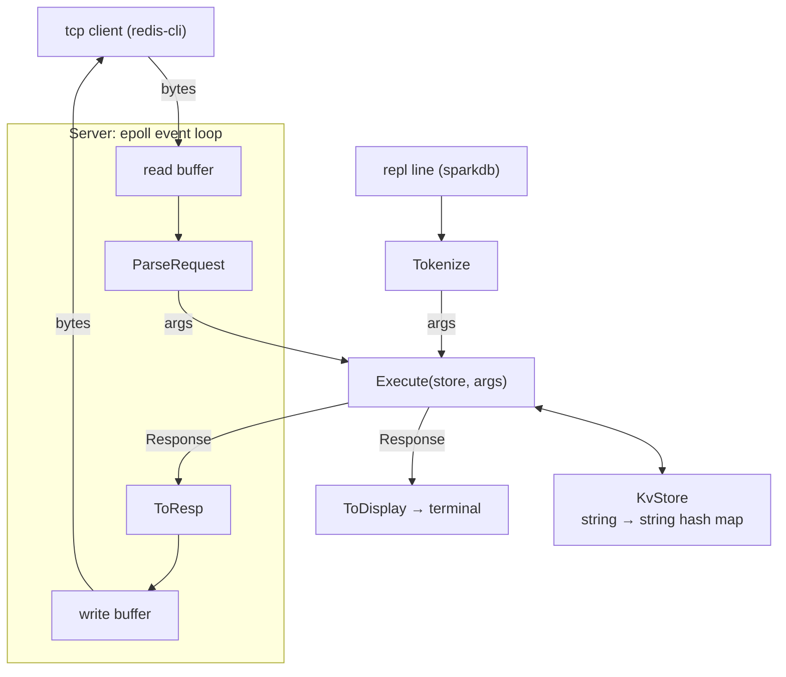
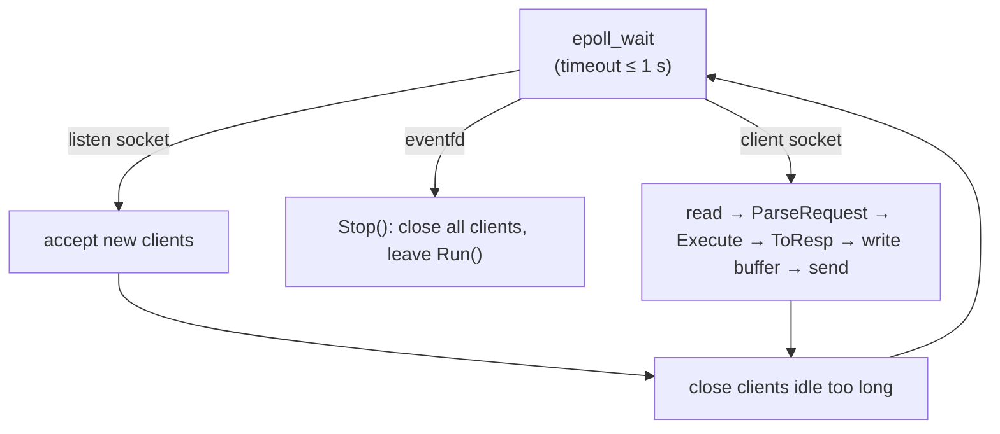

# sparkDB

a tiny redis-style key-value store, written from scratch in c++20.

it speaks a small subset of the redis protocol (RESP2) over tcp, so you can point the real `redis-cli` at it and it just works. under the hood it's a single-threaded `epoll` event loop serving many clients at once, the same basic shape redis itself uses.

i built it to learn how databases like redis actually work: how bytes on a socket become commands, how one thread can juggle thousands of connections, and what can go wrong along the way.

```
$ redis-cli
127.0.0.1:6379> set greeting "hello world"
OK
127.0.0.1:6379> get greeting
"hello world"
127.0.0.1:6379> del greeting
(integer) 1
```

## at a glance

- **~1.98 million ops/sec** for pipelined `PING` (50 clients, 16 commands per batch)
- **~60k ops/sec** for a single client sending one command at a time, at **15 µs** median round trip
- **~5 MB** of memory with 10,000 keys loaded
- one thread, no locks, no external dependencies (catch2 is only used for tests)

numbers and how they were measured are in [speed](#speed) below.

## technical specs

### commands

| command | reply | notes |
|---|---|---|
| `PING [message]` | `+PONG`, or the message back | |
| `SET key value` | `+OK` | overwrites any existing value |
| `GET key` | the value, or a null reply | a missing key is different from an empty value |
| `DEL key` | `:1` if deleted, `:0` if it wasn't there | one key per call |

command names are case-insensitive (`get`, `GET` and `gEt` all work). a wrong number of arguments gets `-ERR wrong number of arguments for 'get' command`, and an unknown command gets `-ERR unknown command 'foo'`.

keys and values are **binary-safe**: they can hold any byte, including `\0` and `\r\n`.

### protocol

- requests are RESP2 arrays of bulk strings, which is exactly what `redis-cli` and redis client libraries send:
  ```
  *3\r\n$3\r\nSET\r\n$3\r\nfoo\r\n$3\r\nbar\r\n
  ```
- replies use the proper RESP2 types: simple strings (`+OK`), errors (`-ERR ...`), integers (`:1`), bulk strings (`$3\r\nbar\r\n`) and null (`$-1\r\n`).
- **pipelining** works: a client can send many commands in one go, and the replies come back in order.
- an empty array (`*0\r\n`) is ignored, like in redis.
- malformed input gets `-ERR Protocol error: <reason>` and the connection is closed (after any earlier replies are sent).
- inline commands (typing raw text over telnet) are not supported.

### limits and defaults

| setting | value |
|---|---|
| listen address | `127.0.0.1:6379` |
| max arguments per command | 1,024 |
| max size of one argument | 1 MiB |
| max connected clients | 1,000 (extra ones get `-ERR max number of clients reached`) |
| idle timeout | 300 seconds with no reads or writes |
| read size per wakeup | 4 KiB |

the client cap and idle timeout live in `ServerConfig` and can be changed from code. there are no command-line flags or config files yet.

### what it deliberately doesn't do

no persistence (everything is in memory and gone on restart), no key expiry / TTL (on purpose), no auth, no TLS, and no clustering.

## architecture

the code is split into small layers, and each one only knows about the layer below it:



- **`RespParser`**: turns raw socket bytes into a list of arguments like `["SET", "foo", "bar"]`. it can tell "this command isn't finished yet, wait for more bytes" apart from "this is garbage", and it enforces the size limits before allocating anything big.
- **`Commands` (`Execute`)**: the only place commands are defined. it does no i/o at all: arguments in, a `Response` out. that's why the network server and the little REPL (`sparkdb`) share the exact same command code.
- **`Response`**: a typed reply (simple, error, integer, bulk, null). the type matters on the wire: `+OK` (a status) and `$2\r\nOK\r\n` (a stored value that happens to be "OK") are different things to a client. `ToResp` also strips `\r\n` from status and error text so a reply can never fake a second reply.
- **`KvStore`**: a plain string-to-string hash map with no idea what a command is.
- **`Server`**: owns the sockets and the event loop.

### how the event loop works

the server is one thread sitting in `epoll_wait`, watching three kinds of file descriptors:



a few design choices worth calling out:

- **everything is non-blocking.** a slow or idle client can never freeze the loop. with blocking sockets, one idle `redis-cli` sitting at its prompt would hold up everyone else.
- **level-triggered epoll.** each wakeup reads at most 4 KiB from a client. if more is waiting, epoll simply wakes us up again. this is simpler than edge-triggered mode and keeps one chatty client from starving the others.
- **per-client write buffers.** replies are appended to a buffer and sent with non-blocking `send`. if the socket is full (say, a 1 MiB value going to a slow reader), the leftover bytes stay queued and the server asks epoll to tell it when the socket is writable (`EPOLLOUT`). once the buffer drains, it stops asking.
- **protocol errors close gracefully.** the client is marked "closing": we stop reading from it, finish sending the replies it already earned plus the error, and only then close it.
- **`Stop()` uses an `eventfd`.** another thread writes to it, which wakes `epoll_wait` straight away. it's thread-safe and needs no locks. the tests use this to start and stop a real server for every test case.
- **idle checks ride on the epoll timeout.** `epoll_wait` waits at most 1 second (or less if the idle timeout is shorter), so idle clients get swept up on a steady beat even when nothing else is happening.

## build, run, test

you need a c++20 compiler, cmake 3.16+, and linux (for `epoll`). the first configure downloads catch2, so it needs internet.

```
cmake -B build -DCMAKE_BUILD_TYPE=Release && cmake --build build
```

this gives you three programs:

```
./build/sparkdb_server    # the tcp server on 127.0.0.1:6379; connect with redis-cli
./build/sparkdb           # a local repl for poking at the store; "exit" or ctrl-d quits
./build/sparkdb_tests     # the test suite
```

run the tests:

```
ctest --test-dir build --output-on-failure    # everything
./build/sparkdb_tests "PING"                  # one test case by name
./build/sparkdb_tests --list-tests            # see what's there
```

there are 42 test cases. the server tests use real sockets against a real server on a random port, covering things like 10,000 pipelined commands sent before reading anything, 8 MiB of replies pushed through a tiny receive buffer, the client cap, idle timeouts, and protocol errors. every read has a timeout, so a bug fails the test instead of hanging it.

the suite also passes under address and undefined-behaviour sanitizers:

```
cmake -B build-asan -DCMAKE_CXX_FLAGS="-fsanitize=address,undefined -fno-sanitize-recover=all" \
      -DCMAKE_EXE_LINKER_FLAGS="-fsanitize=address,undefined" && cmake --build build-asan
./build-asan/sparkdb_tests
```

## speed

### results

ops per second, higher is better. "pipeline 16" means each client sends 16 commands, then reads 16 replies.

| command | 1 client, no pipelining | 1 client, pipeline 16 | 50 clients, no pipelining | 50 clients, pipeline 16 |
|---|---:|---:|---:|---:|
| `PING` | 61,554 | 831,441 | 148,124 | **1,979,087** |
| `SET` | 58,106 | 686,132 | 139,351 | 1,540,177 |
| `GET` | 59,858 | 713,369 | 141,274 | 1,565,469 |

round-trip latency without pipelining:

| command | 1 client p50 / p99 | 50 clients p50 / p99 |
|---|---|---|
| `PING` | 15 µs / 25 µs | 328 µs / 654 µs |
| `SET` | 16 µs / 27 µs | 347 µs / 696 µs |
| `GET` | 15 µs / 25 µs | 344 µs / 688 µs |

server memory after the run, with 10,000 keys loaded: **about 5 MB** (resident set size).

### what the numbers say

- **pipelining is the big win.** going from 1 to 16 commands per batch gives about 12–13x the throughput for a single client. without pipelining, every command costs a full trip through the kernel on both sides (send, wake up, read, reply, wake up), and that overhead dwarfs the actual hash map work.
- **one thread scales across clients.** 50 clients get about 2.4x the throughput of one, all on a single server thread. the loop picks up whichever clients have data each time it wakes up, instead of waiting on any one of them.
- **latency under load is mostly queueing.** with 50 clients, a request waits for its turn behind the others' requests in the same loop, so the median goes from 15 µs to around 340 µs. that's the trade-off of a single-threaded design.
- **`SET` and `GET` cost about the same as `PING`** without pipelining, which shows the network path dominates. with pipelining, the store work starts to show: `SET` and `GET` are about 20% slower than `PING`.

### how it was measured

- **machine:** amd ryzen 5 7530u laptop (6 cores / 12 threads), linux 7.0, g++ 15.2, cmake `Release` build.
- **client:** a small throwaway c++ load tool (not in this repo). it opens n tcp connections over loopback, each on its own thread, sends commands as fast as it can for 3 seconds, and counts completed replies. latency is timed per request, only for the non-pipelined runs.
- **workload:** 10,000 keys loaded beforehand, 32-byte values, random keys for `SET`/`GET`.
- client and server share the same machine and cpu, so the load tool competes with the server for cores. a laptop's power and thermal management also adds some noise. a second run landed within a few percent of these numbers.
- these numbers are **not directly comparable** to `redis-benchmark` output, since that tool works differently. treat them as a rough picture of sparkDB's own behaviour, not a head-to-head with redis.
